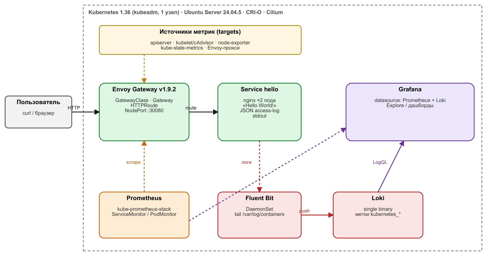

# Kubernetes + Gateway API + Prometheus + Fluent Bit/Loki

Одноузловой кластер Kubernetes (kubeadm), в котором демонстрационное веб-приложение (nginx)
публикуется через **Kubernetes Gateway API** (Envoy Gateway), метрики собирает **Prometheus**,
логи — **Fluent Bit → Loki**. Развёртывание автоматизировано (Ansible + Helm) и сводится к
нескольким командам. Паспорт решения: [docs/Паспорт.pdf](docs/Паспорт.pdf).

## Архитектура



```
Пользователь ─HTTP :30080─> Envoy Gateway (GatewayClass/Gateway/HTTPRoute) ─> Service hello ─> nginx (2 пода)
                                      │                                              │ stdout: JSON access-log
                      Prometheus (kube-prometheus-stack) ──scrape──┐        Fluent Bit (DaemonSet) ─> Loki
                                      └─────────── Grafana (Prometheus + Loki) ◄──────────────────┘
```

## Версии (источник истины: [ansible/group_vars/all.yml](ansible/group_vars/all.yml))

| Компонент | Версия |
|---|---|
| ОС, на которой тестировалось | **Ubuntu Server 24.04.5 LTS** |
| Kubernetes | **1.36** (kubeadm, один узел: control-plane + рабочая нагрузка) |
| CRI | CRI-O v1.36 |
| CNI | Cilium 1.20.2 (только CNI) |
| Gateway API | реализация **Envoy Gateway v1.9.2** (в комплекте Gateway API CRD v1.6.1) |
| Мониторинг | kube-prometheus-stack 91.8.2 (Prometheus Operator, Prometheus, Grafana, node-exporter) |
| Логи | Fluent Bit chart 0.58.2 (Fluent Bit 5.1.2) → Loki chart 18.13.7 (Loki 3.7.8, `grafana-community/loki`) |
| Helm | 3.22.0 |
| Автоматизация | Ansible, Helm, GNU Make, shell |
| Приложение | nginxinc/nginx-unprivileged 1.27-alpine |

Использованные ресурсы Gateway API: `GatewayClass` (`envoy`), `Gateway` (`demo-gw`, порт 80),
`HTTPRoute` (`hello` → Service `hello`), плюс `EnvoyProxy` (параметры GatewayClass: сервис типа NodePort 30080).

## Требования к среде
- Чистая VM **Ubuntu Server 24.04**, 4 vCPU, 8 ГБ RAM, 40 ГБ диска.
- Доступ в интернет (пакеты, Helm-чарты, образы с docker.io / quay.io / registry.k8s.io).
- Пользователь с `sudo`.
- **Статический IP или DHCP-резервация** для узла: kubeadm привязывает сертификаты и etcd к IP, при смене адреса
  после перезагрузки кластер не поднимется (см. «Ограничения»).
- Репозиторий пакетов Kubernetes задаётся переменной `k8s_pkgs_base` (по умолчанию зеркало Яндекса, т.к. `pkgs.k8s.io`
  недоступен из РФ). Вне РФ: `-e k8s_pkgs_base=https://pkgs.k8s.io`.

## Развёртывание

```bash
sudo apt-get update && sudo apt-get install -y git make
git clone https://github.com/artemid00/mts-engineer-hack-devops.git && cd mts-engineer-hack-devops
chmod +x scripts/*.sh

export GRAFANA_ADMIN_PASSWORD='<свой пароль>'   # необязательно; без него будет admin-change-me
sudo -E make deps       # ansible и коллекции
sudo -E make cluster    # kubeadm + CRI-O + Cilium (один узел)
sudo -E make deploy     # Envoy Gateway, Prometheus/Grafana, Loki, Fluent Bit, приложение
sudo make verify        # автоматическая проверка трёх обязательных частей
```

То же одной командой: `sudo -E make all`. Время: ~15–25 минут.
Повторный запуск `make cluster deploy` безопасен (идемпотентен). Полный сброс узла: `sudo make clean`.

Если кластер уже есть, `make deploy` работает на любом кластере с `kubectl`/`helm` (kubeconfig `/etc/kubernetes/admin.conf`).

## Проверка работоспособности

Автоматически: `sudo make verify` — завершается `OK`, если пройдены все три проверки ниже.

### 1. Приложение через Gateway API
```bash
kubectl -n demo get gateway,httproute            # Gateway: PROGRAMMED=True
NODE_IP=$(kubectl get node -o jsonpath='{.items[0].status.addresses[?(@.type=="InternalIP")].address}')
curl http://$NODE_IP:30080/                       # -> Hello World!
```

### 2. Мониторинг (Prometheus)
Собираются метрики kube-apiserver, kubelet/cAdvisor, node-exporter, kube-state-metrics, самого Prometheus,
а также Envoy-прокси Gateway (запросы, коды ответов, latency).
```bash
kubectl -n monitoring port-forward svc/kps-kube-prometheus-stack-prometheus 9090:9090 &
# http://localhost:9090/targets  — все target'ы UP
curl -sG localhost:9090/api/v1/query --data-urlencode 'query=up{job="apiserver"}'   # value "1"
curl -sG localhost:9090/api/v1/query --data-urlencode 'query=sum(up)'
```
Grafana: `kubectl -n monitoring port-forward svc/kps-grafana 3000:80`, логин `admin`, пароль из `GRAFANA_ADMIN_PASSWORD`.

### 3. Логи (Fluent Bit → Loki)
Собираются stdout/stderr всех контейнеров, в т.ч. **access-логи nginx (JSON)** и error-логи (stderr).
```bash
curl http://$NODE_IP:30080/check-123              # сгенерировать запрос
kubectl -n logging port-forward svc/loki 3100:3100 &
curl -sG localhost:3100/loki/api/v1/query_range \
  --data-urlencode 'query={kubernetes_namespace_name="demo"} |= "check-123"'
```
Либо в Grafana: Explore → Loki → `{kubernetes_namespace_name="demo"}`.
Метки: `kubernetes_namespace_name`, `kubernetes_pod_name`, `kubernetes_container_name`, `kubernetes_labels_app`.

## Структура репозитория
```
ansible/                  cluster.yml, addons.yml, роли (prepare, cri-o, kubelet, kubeadm, kubectl, init_master, helm, cilium,
                          gateway_api, monitoring, logging, app), group_vars/all.yml с версиями
charts/demo/              Helm-чарт: nginx, Gateway/HTTPRoute/EnvoyProxy, PodMonitor, datasource Loki для Grafana
k8s/monitoring|logging/   values для kube-prometheus-stack, Loki, Fluent Bit
scripts/                  bootstrap.sh, verify-all.sh, reset.sh
Makefile                  deps | cluster | deploy | verify | all | clean
docs/                     паспорт решения, схема
```

## Дополнительные возможности
- **Один Helm-чарт приложения** (`charts/demo`): nginx, Gateway API (GatewayClass/Gateway/HTTPRoute/EnvoyProxy),
  мониторинг и datasource; параметры в `values.yaml` (реплики, образ, NodePort, hostname для маршрута).
- **Идемпотентная автоматизация:** `helm upgrade --install`, проверки наличия `admin.conf`, закреплённые версии всех
  компонентов; изменение ConfigMap nginx автоматически перекатывает поды (checksum-аннотация).
- **Самолечение при установке:** если CoreDNS застревает из-за гонки при старте Cilium, роль перезапускает агент CNI.
- **Скрипт проверки** `scripts/verify-all.sh` для всех трёх обязательных частей и **скрипт полного сброса** `scripts/reset.sh`.
- **Структурированные access-логи nginx (JSON)** с кодом ответа, временем запроса, методом, URI — удобно для поиска в Loki.
- **Метрики Envoy-прокси** (PodMonitor): число запросов, коды ответов, latency на уровне Gateway.
- **Grafana** с автоматически подключёнными datasource Prometheus и Loki.
- **Безопасность и надёжность приложения:** запуск не от root, `readOnlyRootFilesystem`, `drop: [ALL]`,
  `seccompProfile: RuntimeDefault`, probes, лимиты ресурсов, 2 реплики. Секретов в репозитории нет, пароль Grafana
  передаётся через переменную окружения.

## Известные ограничения
- Один узел, без HA; kubeadm требует **неизменного IP** узла (статический адрес или DHCP-резервация).
- Loki хранит данные без постоянного тома (`persistence: false`, filesystem в поде) — логи теряются при пересоздании пода;
  Prometheus тоже без PV, retention 2 дня.
- TLS на Gateway не настроен, листенер только HTTP :80 (доступ по NodePort 30080).
- Образы берутся из публичных реестров (docker.io, quay.io, registry.k8s.io); при их недоступности нужно настроить зеркало.
- Пароль Grafana по умолчанию (`admin-change-me`) должен быть заменён через `GRAFANA_ADMIN_PASSWORD`.
- Тестировалось на Ubuntu Server 24.04.5 LTS (x86_64); другие ОС и архитектуры не проверялись.
